# loteria_push

# Capturas de las pruebas (TDD)

Cada captura va en orden: ronda, resultado (ROJO = falla, VERDE = pasa) y la imagen.

## 1. Ronda 2 · Baraja (servidor)
**Resultado: ROJO ❌** — Falla: aún no existe `baraja.js`.

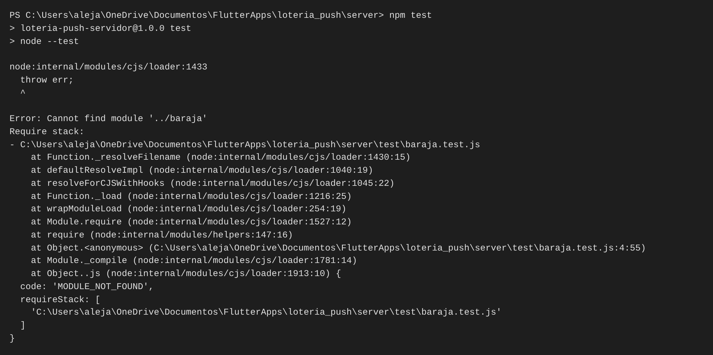

## 2. Ronda 2 · Baraja (servidor)
**Resultado: VERDE ✅** — Pasan las 6 pruebas.

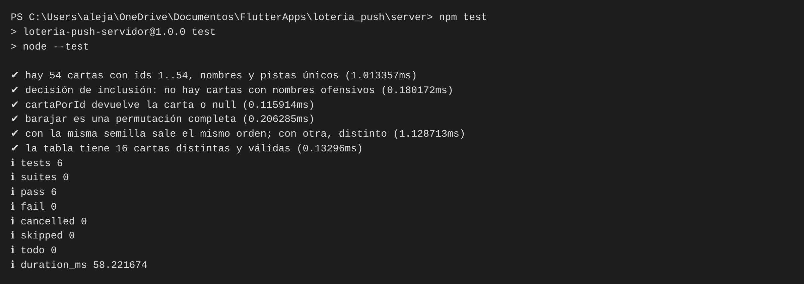

## 3. Ronda 2 · Líneas y patrones (servidor)
**Resultado: ROJO ❌** — Falla: aún no existe `lineas.js`.

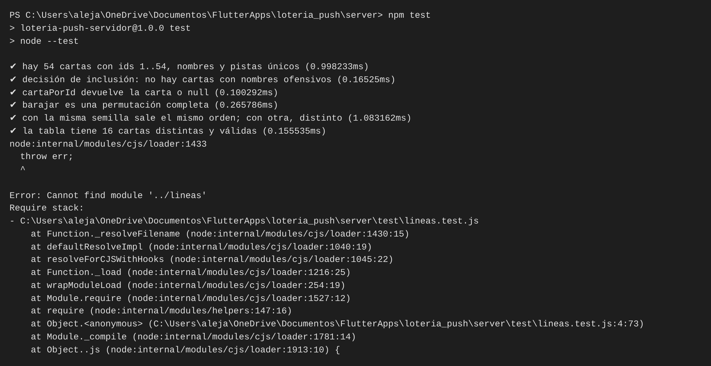

## 4. Ronda 2 · Líneas y patrones (servidor)
**Resultado: VERDE ✅** — Pasan las 22 pruebas acumuladas.

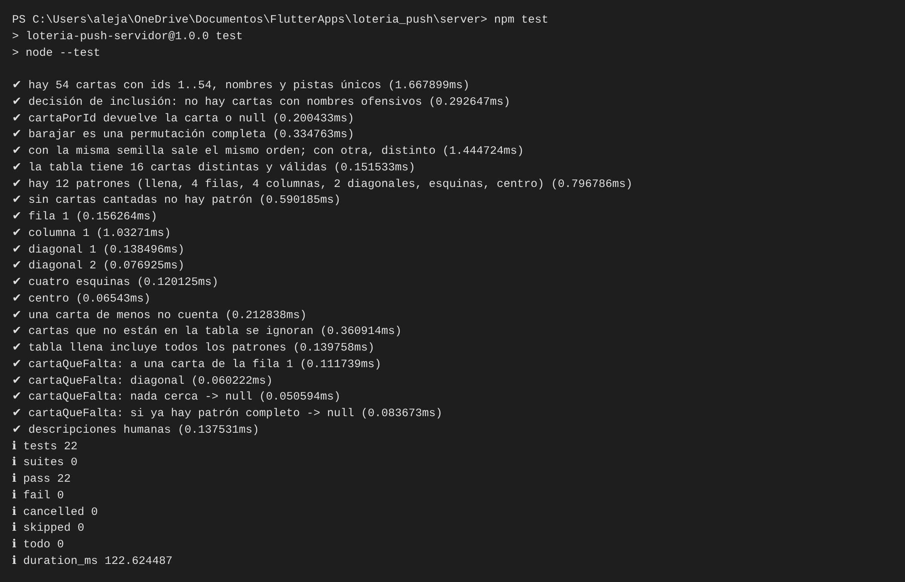

## 5. Ronda 3 · Mensajes push (servidor)
**Resultado: ROJO ❌** — Falla: aún no existe `mensajes.js`.

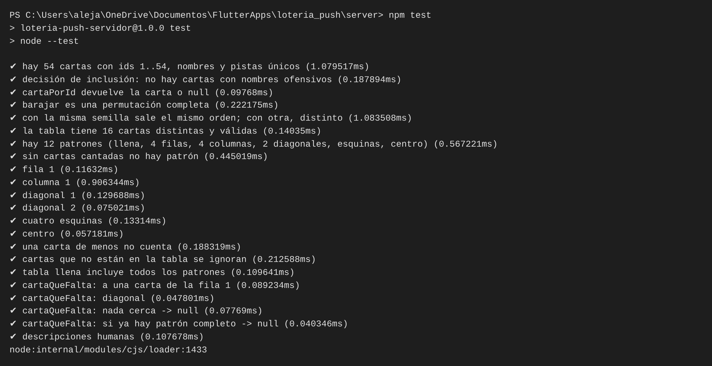

## 6. Ronda 3 · Mensajes push (servidor)
**Resultado: VERDE ✅** — Pasan las pruebas de mensajes.

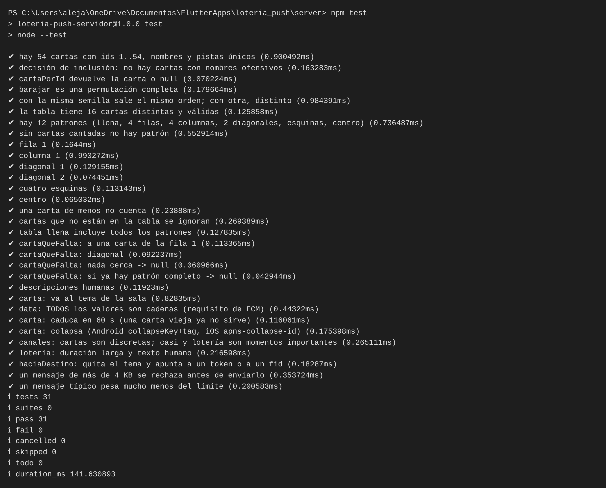

## 7. Ronda 4 · La sala (servidor)
**Resultado: ROJO ❌** — Falla: aún no existe `sala.js`.

## 8. Ronda 4 · La sala (servidor)
**Resultado: VERDE ✅** — Pasan las pruebas de la sala.

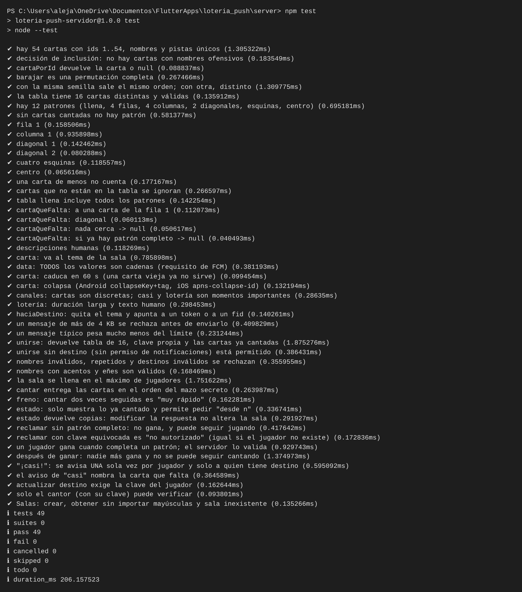

## 9. Ronda 5 · Servidor HTTP (servidor)
**Resultado: ROJO ❌** — Falla: aún no existe `servidor.js`.

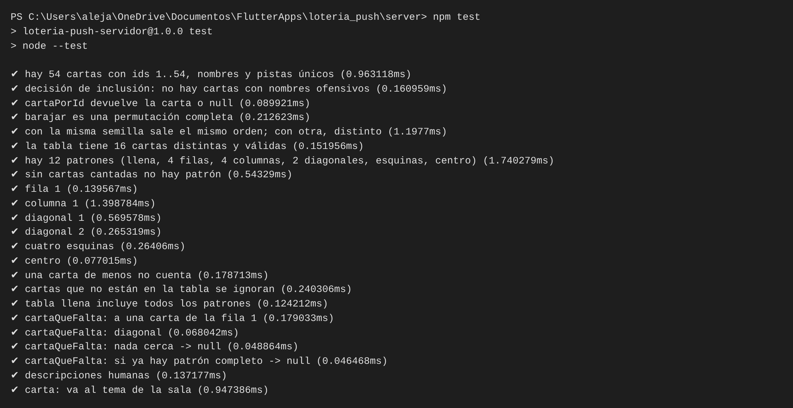

## 10. Ronda 5 · Servidor HTTP (servidor)
**Resultado: VERDE ✅** — Pasan las pruebas de punta a punta.

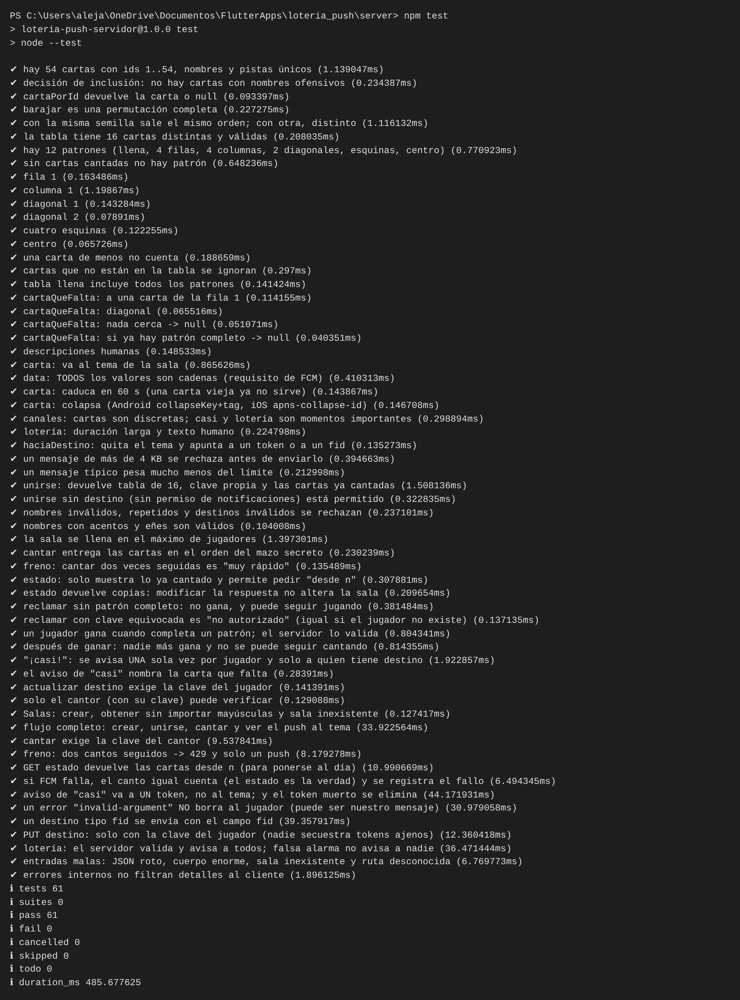

## 11. Ronda 5 · Suite completa del servidor
**Resultado: VERDE ✅** — `npm test`: 61 de 61 pruebas pasan.

## 12. Ronda 5 · Servidor en marcha
**Resultado: EJECUCIÓN** — `npm start` levanta el cantor y muestra el push simulado.

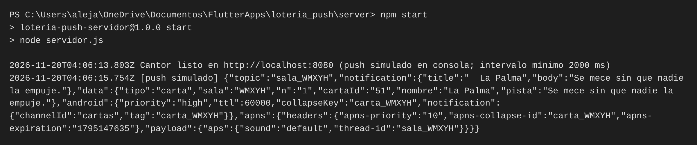

## 13. Ronda 5 · Prueba manual con curl
**Resultado: EJECUCIÓN** — Crear sala, unirse, cantar y ver el estado.

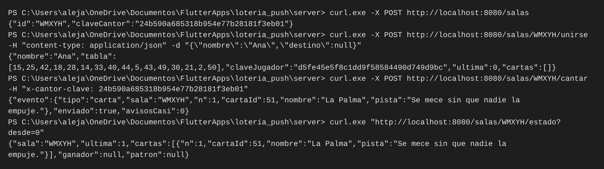

## 14. Ronda 6 · Eventos y patrones (app)
**Resultado: ROJO ❌** — Falla: faltan `evento.dart` y `lineas.dart`.

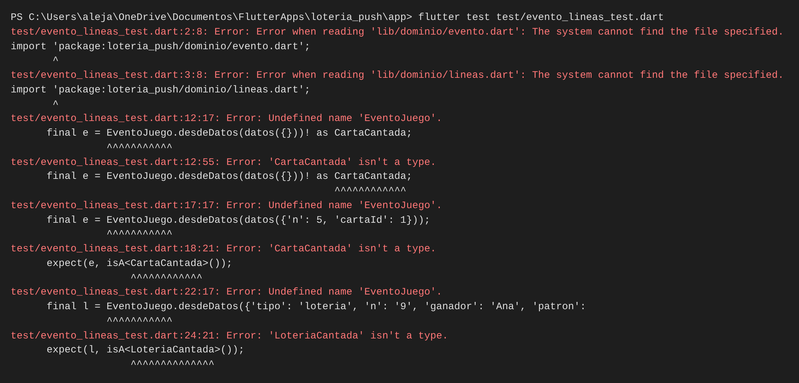

## 15. Ronda 6 · Eventos y patrones (app)
**Resultado: VERDE ✅** — Pasan las 17 pruebas.

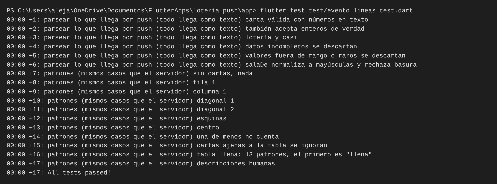

## 16. Ronda 6 · Partida (app)
**Resultado: ROJO ❌** — Falla: falta `partida.dart` y `falsos.dart`.

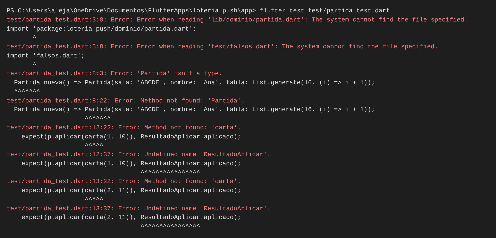

## 17. Ronda 6 · Partida (app)
**Resultado: NO PASA ❌** — Con `partida.dart` creado, sigue fallando: `falsos.dart` se crea hasta la Ronda 7 (error del manual).

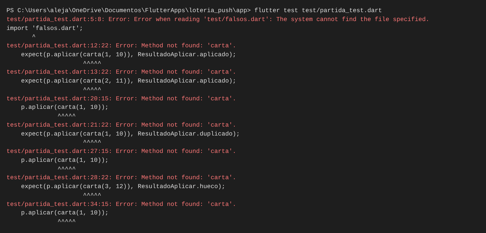

## 18. Ronda 6 · Partida (app)
**Resultado: VERDE ✅** — Con `falsos.dart` y sus puertos creados, pasan las 10 pruebas.

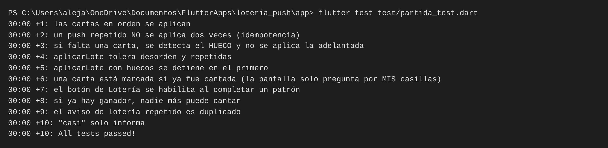

## 19. Ronda 7 · Controlador (app)
**Resultado: ROJO ❌** — Falla: falta `controlador.dart`.

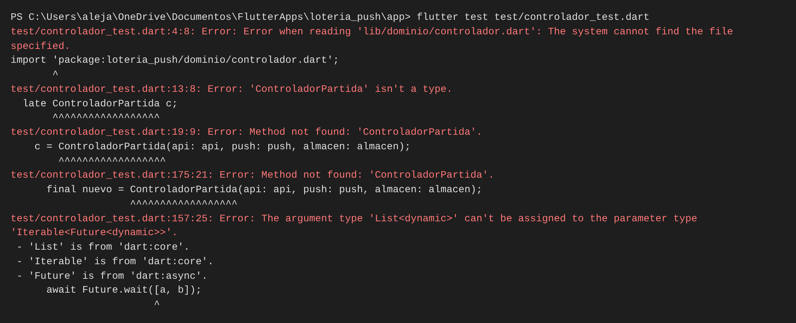

## 20. Ronda 7 · Controlador (app)
**Resultado: VERDE ✅** — Pasan las 22 pruebas.

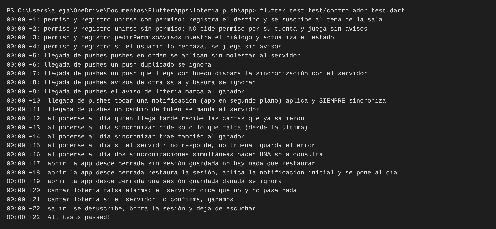

## 21. Ronda 7 · Suite completa de la app
**Resultado: VERDE ✅** — `flutter test`: 49 pruebas pasan.

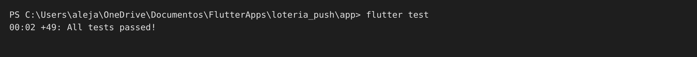

